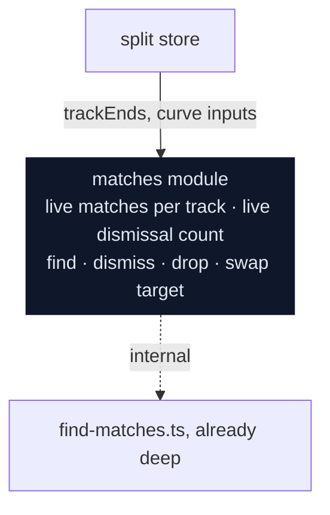
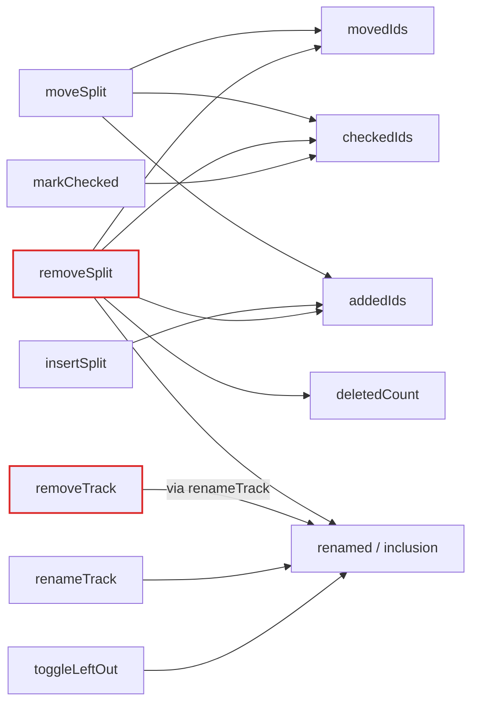
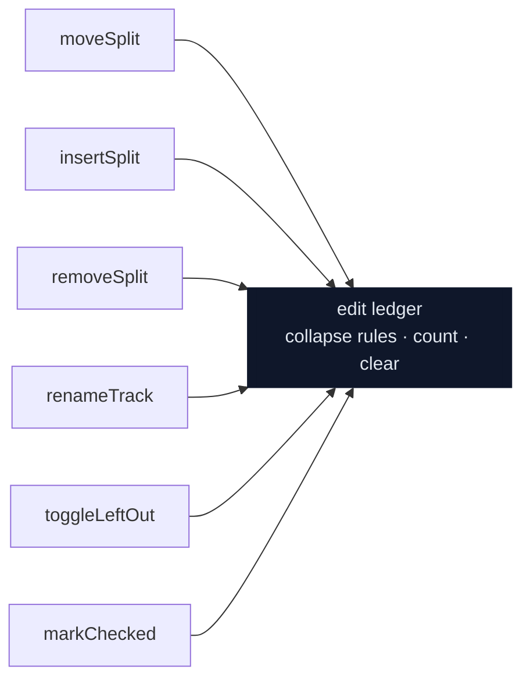
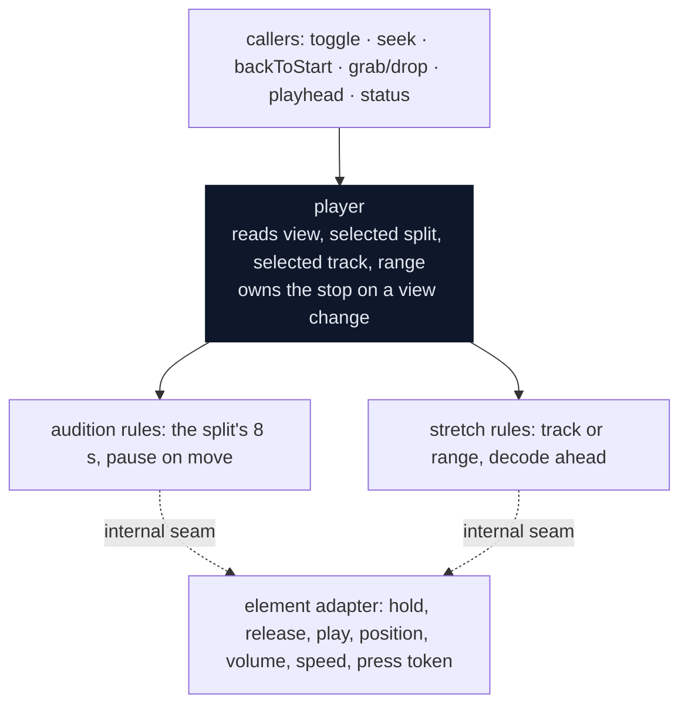
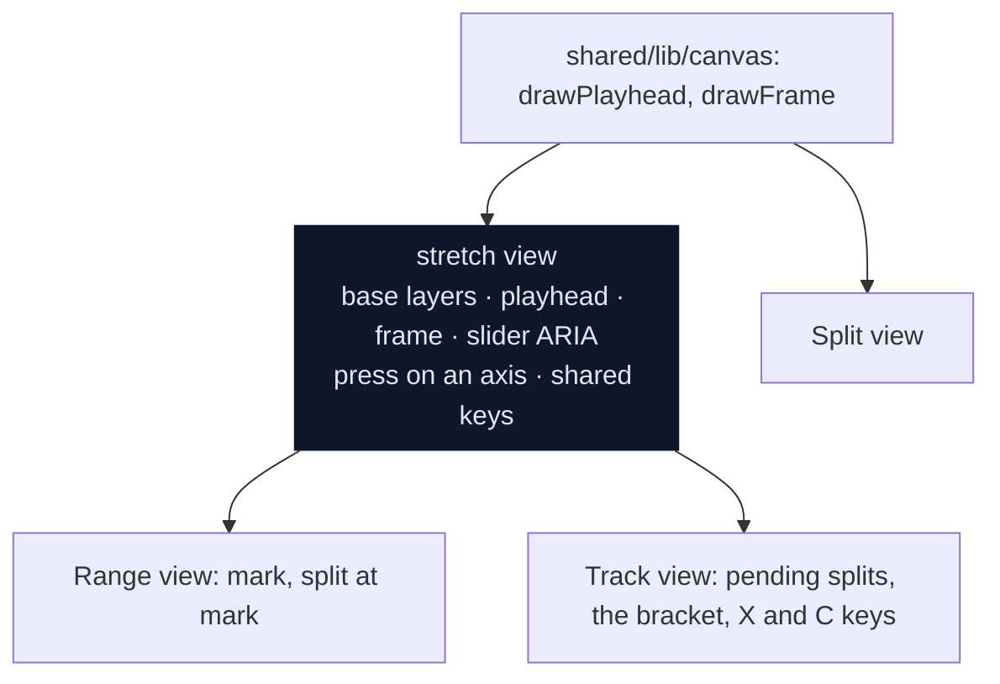
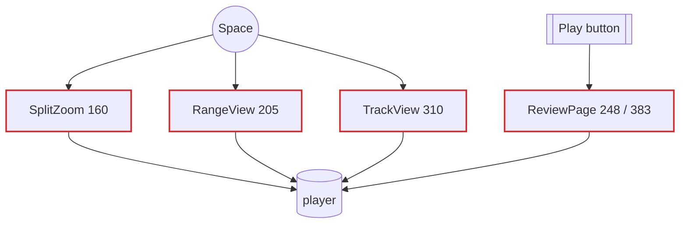
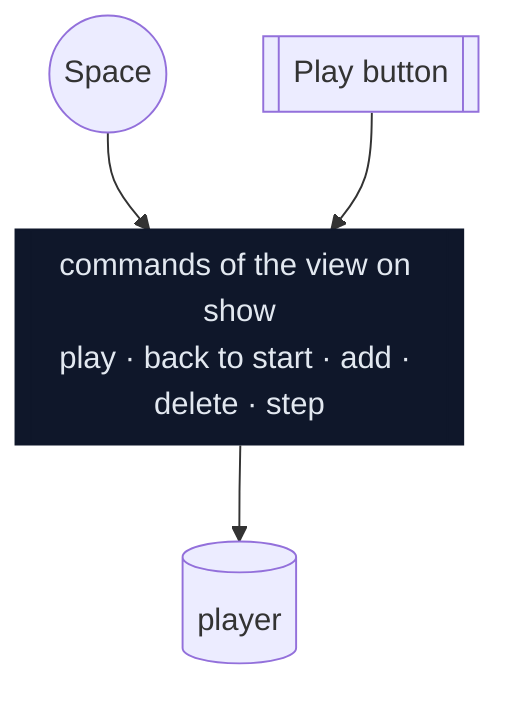
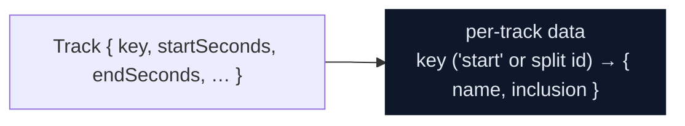
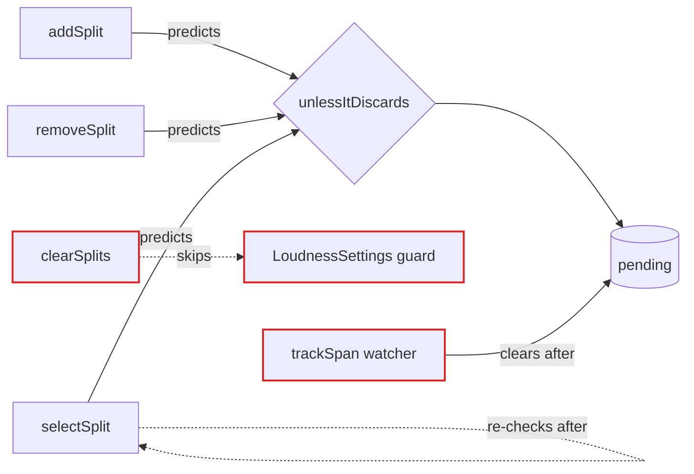
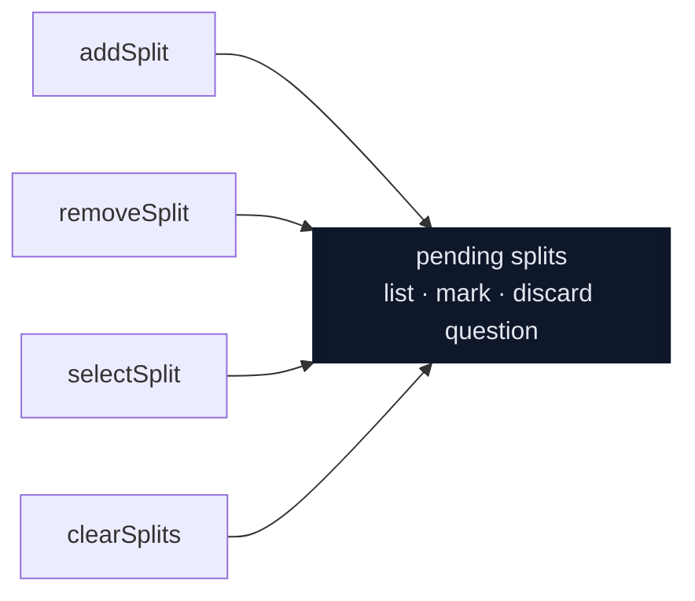

# Architecture review: where the complexity piled up

Date: 2026-11-25 · branch `refactor/code-cleanup-and-readability`, from `4eb0831` (release 2.0.0)

The review started from the git hot spots of the last 3 months. Line numbers refer to `4eb0831`.

| File                                       | Lines | Commits in 3 months |
| ------------------------------------------ | ----: | ------------------: |
| `src/entities/split/model/split.ts`        |  1521 |                  49 |
| `src/widgets/split-zoom/model/audition.ts` |   821 |                  21 |
| `src/pages/review/ui/ReviewPage.vue`       |   461 |                  37 |
| `src/widgets/split-zoom/ui/TrackView.vue`  |   424 |                  20 |
| `src/widgets/split-zoom/ui/SplitZoom.vue`  |   381 |                  19 |
| `src/widgets/split-zoom/ui/RangeView.vue`  |   298 |                  14 |

Vocabulary: **module**, **interface** (everything a caller must know), **depth** (behaviour per unit of interface), **seam**, **adapter**, **leverage**, **locality**, from the `codebase-design` skill. Domain terms come from `GLOSSARY.md`.

## Summary

| #   | Candidate                                                | Strength                                                | Area             |
| --- | -------------------------------------------------------- | ------------------------------------------------------- | ---------------- |
| 1   | Give matches their own module                            | Strong                                                  | split store      |
| 2   | One edit ledger for the Edit rules                       | Strong                                                  | split store      |
| 3   | One player interface that knows what is on show          | Strong (interface), Worth exploring (one state machine) | split-zoom       |
| 4   | A shared stretch view for the Range and Track views      | Strong                                                  | split-zoom       |
| 5   | Each action written once, for its key and its button     | Worth exploring                                         | page, split-zoom |
| 6   | One home for per-track data, no first-track special case | Worth exploring                                         | split store      |
| 7   | Pending splits decide for themselves what discards them  | Worth exploring                                         | split store      |

**Top recommendation:** start with 1. It is the largest single concept in the hottest file, and its design is already sound, so the move is low-risk. Do 2 next, in the same file. The quickest win elsewhere is 4.

## The split store at a glance

`split.ts` returns 80 members: about 18 writable refs, 19 computeds and 43 actions. 15 files consume it; the heaviest are `ReviewPage.vue` (28 members), `LoudnessSettings.vue` (24) and `TrackView.vue` (19). Its 45-line doc comment (167–211) works as a table of contents for about 8 concepts.

| Lines     | What                                                                                                                           | ~Lines |
| --------- | ------------------------------------------------------------------------------------------------------------------------------ | -----: |
| 1–47      | Imports, built-in settings, `snapToGrid`                                                                                       |     47 |
| 49–165    | Types; match identity helpers `heldOf`, `isSameTrack`, `isSamePair`                                                            |    117 |
| 213–305   | About 35 pieces of state: settings, splits, names, inclusion, selection, view, range, marks, pending, matches, the edit ledger |     93 |
| 307–331   | Selected index, `trackEnds`                                                                                                    |     25 |
| 333–397   | Match liveness, the `wayBack` watcher                                                                                          |     65 |
| 399–449   | `tracks`: one map for inclusion, matches, names, export numbers                                                                |     51 |
| 451–548   | Selected track, end splits, `trackSpan` watcher, `unlessItDiscards`                                                            |     98 |
| 550–629   | Edit count, `exportTrackCount`, room checks, `canAdd*`                                                                         |     80 |
| 631–811   | Settings, defaults, `open`, `clearSplits`, gaps, dips, `findSplits`                                                            |    180 |
| 813–977   | Find duplicates, `dismissMatch`, `swapTarget`, `swapTrack`                                                                     |    165 |
| 979–1139  | Selection, navigation, confidence queue, `markChecked`, `moveZoomTo`, range, marks                                             |    160 |
| 1141–1200 | Pending-split actions, `showView`                                                                                              |     60 |
| 1202–1406 | Mutations: move, insert, add, delete, remove, `removeTrack`, rename, `toggleLeftOut`                                           |    205 |
| 1408–1437 | Prefix, `reset`                                                                                                                |     30 |
| 1439–1520 | The returned interface                                                                                                         |     82 |

---

## 1. Give matches their own module

**Strong** · in-process

**Files:** `src/entities/split/model/split.ts`, `src/entities/split/lib/find-matches.ts`, `src/entities/split/lib/match-words.ts`, `src/entities/split/model/__tests__/find-duplicates.spec.ts`

**Before: one concept, nine places in `split.ts`**

| Lines     | Match code                          |
| --------- | ----------------------------------- |
| 121–165   | Match types, `heldOf`, `isSamePair` |
| 264–290   | Search state, dismissals, `wayBack` |
| 333–397   | Liveness and the `wayBack` watcher  |
| 401–435   | Inside the `tracks` map             |
| 566       | Inside `editCount`                  |
| 679       | `dropMatches` in `open`             |
| 813–977   | Find, dismiss, swap                 |
| 1393–1397 | Inside `toggleLeftOut`              |
| 1427      | `dropMatches` in `reset`            |

**After: the store holds a deep module**

Inside the module: the search with its press number and abort, the mapping between held tracks and indices, the dismissals and the way back. `swapTrack` keeps its `selectTrack` call in the store.

**Problem:** to learn duplicates you read nine places in a 1521-line closure. `findDuplicates` (856–901) converts between indices and held tracks by hand (875–880, 891–897).

**Solution:** one module inside `model/`. It is fed `trackEnds` and owns the search, the stored matches, the dismissals and the way back. The store only reads live matches from it.

**Wins:**

- Locality: about 330 lines leave `split.ts`
- Tests use a plain `trackEnds` ref instead of building every case through the store's split actions
- `find-matches.ts` (342 lines) gets a direct spec; it has none today
- The liveness design stays: a match keeps both tracks' ends and its liveness is derived, so no edit has to invalidate it

---

## 2. One edit ledger for the Edit rules

**Strong** · in-process

**Files:** `src/entities/split/model/split.ts` (298–305, 550–570, 1063, 1225–1228, 1244, 1303–1307, 1352–1360, 1378, 1405)

**Before: 7 actions write 6 collections by hand**

| Call site               | What it does to the ledger by hand                                         |
| ----------------------- | -------------------------------------------------------------------------- |
| `markChecked` 1063–1064 | Clears confidence, adds to `checkedIds`                                    |
| `moveSplit` 1225–1228   | Clears confidence; counts as moved unless added; deletes from `checkedIds` |
| `insertSplit` 1244      | Adds to `addedIds` when manual                                             |
| `removeSplit` 1303–1307 | Five deletes, bumps `deletedCount` unless added                            |
| `removeTrack` 1352–1360 | Calls `renameTrack` for its edit side effect, patches `inclusionKeys`      |
| `renameTrack` 1378–1379 | Records the rename                                                         |
| `toggleLeftOut` 1405    | Records the inclusion change                                               |

**After: actions report the edit; the ledger keeps the rules**

**Problem:** the glossary's Edit rules (counted once per thing; an added then moved split counts once; a moved split loses checked) are spread over seven actions. They hold only because each action remembers them. Confidence and checked are coupled the same way. A new kind of edit has to touch several functions plus `clearEdits` and `editCount`.

**Solution:** a small module with one operation per glossary edit: split added, moved, deleted, checked; track renamed; inclusion toggled. The collapse rules and the count live inside it.

**Wins:**

- The invariant lives in one place
- The "edit count" tests (`split.spec.ts` 2934–3152) become a small pure spec of the rules; the store spec only checks each action reports its edit
- A new kind of edit touches one file
- `removeTrack` stops renaming for side effects

---

## 3. One player interface that knows what is on show

**Strong** for the interface · **Worth exploring** for merging the two state machines · local-substitutable

**Files:** `src/widgets/split-zoom/model/audition.ts`, `src/pages/review/ui/ReviewPage.vue` (219–250, 273, 354–398), `src/widgets/split-zoom/ui/TrackView.vue`, `src/widgets/split-zoom/ui/RangeView.vue`

**`audition.ts` at a glance** (returns 24 members, 795–820)

| Lines   | What                                                                                                                |
| ------- | ------------------------------------------------------------------------------------------------------------------- |
| 34–98   | Header comment describing two state machines                                                                        |
| 103–141 | 13 pieces of state: `status`, `stretchStatus`, `resting`, `press`, `element`, `url`, `held`, `upcoming`, `ahead`, … |
| 143–204 | Volume and play speed                                                                                               |
| 206–256 | Element and WAV plumbing: `release`, `forgetAhead`, `offsetOf`, `beginPress`                                        |
| 257–347 | Stop, pause and let-go for both modes, `fail`                                                                       |
| 349–363 | The one `<audio>` element; its listeners branch on which status is `playing`                                        |
| 365–519 | The audition: `start`, `toggle`, `seekAudition`, `backToAuditionStart`, grab and drop                               |
| 521–708 | The stretch: `playStretch` decode loop, `seekStretch` (4 branches), `fetchAhead`, `carryOn`                         |
| 710–732 | The two playhead readers                                                                                            |
| 734–793 | Three sync watchers on the split store                                                                              |

**Before: two machines, six mirrored pairs**

| Audition               | Stretch                       |
| ---------------------- | ----------------------------- |
| `toggle`               | `toggleStretch(stretch)`      |
| `seekAudition`         | `seekStretch(stretch, s)`     |
| `backToAuditionStart`  | `backToStretchStart(stretch)` |
| `grabAuditionPlayhead` | `grabPlayhead`                |
| `dropAuditionPlayhead` | `dropPlayhead`                |
| `playheadSeconds`      | `stretchPlayheadSeconds`      |
| `status`               | `stretchStatus`               |

Hidden state machine, kept by hand:

- "At most one of `status` and `stretchStatus` is not idle" is enforced at 4 sites (340–342, 369, 427–428, 536).
- "The audition still holds its WAV" is written `url !== undefined && status === 'paused'` (462, 751), but `url` is shared with the stretch.
- `stop()` (272–279) pauses a stretch but releases the audition.
- `press++` is written directly at 5 sites (260, 273, 300, 404, 761) instead of calling `beginPress`.
- The page (235–240), TrackView (79) and RangeView each work out which `stretch` is on show, though the store already reads `view`, `range` and `selectedTrack` (526, 773, 782).
- The stop on a view change lives in the page (273, async), while the other stop rules are the store's sync watchers.

History: pause, seek and drag came to the audition after the stretch had them (`d50d437`, `85ecd5a`, `2c7e6b4`, `be90ac2`), hence the mirrored pairs.

**After: one set of verbs, the subject read from the split store**

The element adapter is the internal seam: the real `<audio>` in the app, a fake element in tests.

**Problem:** each verb exists twice, and callers pass a `stretch` the player could work out itself.

**Solution:** callers say "toggle" and the player works out what is on show. An internal element adapter carries the `<audio>` plumbing. The open question is whether audition and stretch become one state machine: the audition is close to a one-window stretch, with the split id as identity and "pause and keep the place" as its moved rule.

**Wins:**

- Leverage: 6 verbs instead of 12
- The page's play-button tables (219–250) and twin play-button blocks (354–398) shrink
- `audition.spec.ts` (2885 lines) has mirrored sections ("pausing", "moving the playhead", "playing the range", "playing a track"); they become one suite per verb, run for each subject
- The adapter is tested on its own with a fake element

**ADRs:** 0004 is kept (one element, `playbackRate`). The two state diagrams in `docs/architecture.md` would change.

---

## 4. A shared stretch view for the Range and Track views

**Strong** · in-process

**Files:** `src/widgets/split-zoom/ui/RangeView.vue`, `src/widgets/split-zoom/ui/TrackView.vue`, `src/widgets/split-zoom/lib/use-range-press.ts`, `src/widgets/split-zoom/ui/SplitZoom.vue`, `src/shared/lib/canvas/`

**Before: about 230 lines written twice**

| View        | Lines | Shared with the other |
| ----------- | ----: | --------------------: |
| `RangeView` |   298 |                  ~230 |
| `TrackView` |   424 |                  ~230 |

The shared parts: `draw` (Range 74–131, Track 98–156), `playheadSeconds`, `heardSeconds`/`sliderSeconds`, `axis`, the `useRangePress` wiring, `moveBy`, the Space/Home/arrow keys, `usePlayheadFrames`, the redraw watch and the template. `FRAME_WIDTH`, `PLAYHEAD_WIDTH`, the playhead and frame drawing and the failure `
` are repeated in all three views. `useRangePress` takes 10 callbacks, and TrackView rebuilds the `axis()` mapping inside four of them (174–214).

**After: one stretch view, two thin additions**

**Problem:** a fix to the playhead, the arrows or the slider must be made twice. `useRangePress` is shallow: its 10 callbacks make an interface about as wide as its implementation.

**Solution:** one stretch view (a component or a composable) owns everything the two views share. Each view adds only its own parts. The press composable takes an axis and times rather than pixel arrays.

**Wins:**

- About 20 duplicated spec cases in `RangeView.spec.ts` (41) and `TrackView.spec.ts` (75) run once: arrows, Home, playhead drag, slider value, the failure line
- Locality: one playhead to fix
- The Split view keeps its own drag and only shares the drawing helpers

**ADRs:** 0002 is untouched. The `canvas-view` skill points at RangeView's `isKeyActedOn` as its example and would need updating.

---

## 5. Each action written once, for its key and its button

**Worth exploring** (moving the title row into the widget: Speculative) · in-process

**Files:** `src/pages/review/ui/ReviewPage.vue`, `src/widgets/split-zoom/ui/SplitZoom.vue`, `src/widgets/split-zoom/ui/TrackView.vue`, `src/widgets/split-zoom/ui/RangeView.vue`, `src/widgets/track-strip/model/export-single.ts`, `src/widgets/shortcuts-dialog/config/shortcut-sections.ts`

**Before: each action coded as a key and again as a button**

| Action | Key handlers                                | Button              |
| ------ | ------------------------------------------- | ------------------- |
| Space  | SplitZoom 160, RangeView 205, TrackView 310 | ReviewPage 248, 383 |
| Home   | SplitZoom 167, RangeView 213, TrackView 329 | ReviewPage 243      |
| Enter  | RangeView 194, TrackView 239                | ReviewPage 176–184  |
| Delete | SplitZoom 178, TrackView 321                | ReviewPage 186–195  |

The hint strings and the rows in `shortcut-sections.ts` are separate again.

"Keep playing across a step" (SplitZoom 138–143, TrackView 260–265, the swap at 290–305) depends on an order callers must know: read whether sound was on, change the split store (whose sync watcher releases the old sound), then call toggle again.

**After: the view on show owns one command set**

**ReviewPage.vue at a glance:** keys `?`, `{`, `}` (93–105); open and reset (107–118); stop before export (120–142); "Saved…" watcher (149–159); export gating (162–170); add and delete by view (176–199); title per view (203–216); play-button labels and `backToStart` by view (219–250); discard dialog and view control (253–270); stop on view change (273–278); template with nine icon buttons gated on the view (294–422). It imports 5 lib files and 6 components from split-zoom, so much of the zoom panel's behaviour lives in the page.

**Problem:** every action is written twice, and the step-while-playing rule is an ordering every caller must repeat.

**Solution:** each view exposes one set of commands that its keys and the page's buttons both call. Stepping while sound plays becomes one player action.

**Wins:**

- Button behaviour is tested in widget specs, not by mounting the whole page
- `ReviewPage.spec.ts` (3114 lines; "previous and next track keys" alone is about 400) shrinks
- The ordering rule moves inside one action

**ADRs:** keeps 0002. Moving the title row into split-zoom hits ADR 0001: one widget can't import another, and "Export track/range…" comes from track-strip. The ADR stays; the friction suggests `export-single` may sit in the wrong slice.

---

## 6. One home for per-track data, with no first-track special case

**Worth exploring** · in-process

**Files:** `src/entities/split/model/split.ts` (233–235, 324, 410–413, 1241, 1331–1376, 1398–1404), `src/widgets/track-list/ui/TrackList.vue` (128, 171), `src/widgets/split-zoom/ui/TrackView.vue` (280), `src/widgets/track-strip/model/export-single.ts` (112)

**Before: two storage shapes, chosen at each read**

- `firstTrackName` and the first track's inclusion are refs (233–235).
- Every other track's name and inclusion sit on its start split.
- `startSplitId === null ? first… : split…` branches at 324, 410–413, 1241, 1343–1361, 1370–1376, 1398–1404.
- `startSplit?.id ?? null` is written 13 times, 4 of them in widgets.
- `startSeconds + lengthSeconds` is recomputed 9 times.
- `renameTrack` and `toggleLeftOut` take an id; `selectTrack`, `removeTrack` and `dismissMatch` take a `Track`.

**After: one map, the file start an ordinary key**

**Problem:** the glossary says a track name belongs to the split where the track starts, "or to the start of the source file". That "or" became a branch at every read and write, and makes `removeTrack` (1331–1362) the hardest function in the store to read.

**Solution:** keep names and inclusion in one map keyed by track key. `Track` carries `key` and `endSeconds`.

**Wins:**

- Removes 6 branches
- Widgets stop rebuilding the track key
- Actions take one kind of argument

---

## 7. Pending splits decide for themselves what discards them

**Worth exploring** · in-process

**Files:** `src/entities/split/model/split.ts` (451–548, 799–805, 1008, 1023, 1053, 1089, 1141–1200, 1269–1274, 1291, 1340), `src/widgets/loudness-curve/ui/LoudnessSettings.vue` (49)

**Before: two mechanisms guard one invariant**

- Each action predicts whether it discards: inside the selected track (799–805 and 1269–1274, duplicated), `isSelectedTrackEnd` (1291, 1340), `!isTrackSelected` (1008), default `true` for the rest.
- The `trackSpan` watcher (488–495) also clears them after the fact.
- `clearSplits` skips the question; `LoudnessSettings.vue:49` asks through its own guard.
- Three selectors re-check afterwards whether their selection happened (1023, 1053, 1089), because `unlessItDiscards` doesn't return whether it ran.

**After: callers describe the change, the module decides**

**Problem:** the rule "the user is asked before anything that would discard pending splits" is enforced by predictions at each call site plus a watcher afterwards.

**Solution:** one module owns the pending list, the Track view mark and the discard question. Callers describe the change (times added, splits removed, the new selection); the module says whether it discards and whether the change went ahead.

**Wins:**

- One mechanism, not two
- The "pending splits" and "discard question" specs (`split.spec.ts` 3480–4236, about 750 lines) get a smaller surface
- `LoudnessSettings` drops its own guard

---

## Also noticed

Small, no deepening needed:

- `lib/find-matches.ts`, `lib/propose-splits.ts` and `lib/find-dips.ts` have no specs of their own. They are tested only through the store, which breaks the store-wiring rule "pure maths goes in lib/ with its own spec".
- `audition.ts` 782–788 rebuilds the store's `trackSpan` key (461–482). At 308 it works out the file's end from the last track, because the store doesn't expose the duration.
- `insertSplit` (1237) doesn't check room; each of its four callers does (`addSplit`, `addSplitAt`, the pending-room check, `proposeSplits`).
- "Widgets never assign" is kept by convention only: 18 refs and the `Split` objects are writable. No widget writes to them today.
- The store-wiring skill names `split.detect`; the function is `open`. `firstTrackName` is exported but no consumer reads it.
- The "Saved…" line is cleared three ways in `ReviewPage.vue`: the watcher (149–159), `@pointerdown.capture` (413) and `@acted` (414–415). One rule inside `export-single` would remove two.
- Spec balance: about 6100 lines test through the split store; about 290 test its `lib/`.

## Considered and rejected

- **Separate Pinia stores per concept:** each would need wiring through the page. Modules inside the split slice give the same locality.
- **Detection as its own module** (213–231, 631–789): it separates cleanly but buys little. Its real gap is the missing lib specs above.
- **Selection, view, range and marks as a widget store:** selection is keyed by split id and changed by `removeSplit` and the discard flow, so moving it out needs wiring through the page.
- **Counting edits by diffing against a baseline:** it changes behaviour, because a split moved back would stop counting.
- **Splitting `find-matches.ts`:** it is already deep, one function over a five-stage pipeline. Its only leaks are index-based output and its kind names in `match-words.ts`.
- **Moving volume and play speed out of `audition.ts` alone:** it fails the deletion test; it belongs in the element adapter of 3.
- **Opening the file, and stopping sound before an export, from the page:** both belong there, because `split` can't import `source-file` and widgets can't import each other.
- **Folding the Split view into the stretch view:** its drag, handle, audition edges and zoom window really differ.
- **Generating the shortcuts dialog from the keymaps:** ADR 0001 forbids widget-to-widget imports, and the dialog is hand-written on purpose.
- **`usePlayheadFrames`, `stepOfKey`, `decode-window`, `usePageKeys`, `useSplitDrag`:** small, deep enough and well tested, or one consumer doing real work. Leave them.
