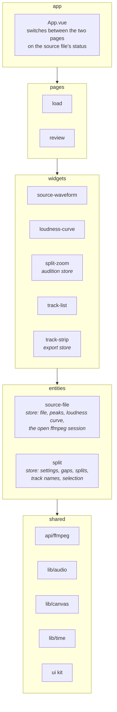

# Audio Splitter

Audio Splitter takes one long audio file of tracks played back to back and turns it into one file per track. It suggests where each track ends, lets you check and correct every cut by eye and by ear, and writes the tracks to a folder without re-encoding them.

It runs entirely in the browser. The file is never uploaded: decoding, analysis and cutting all happen on your machine, through ffmpeg compiled to WebAssembly.

## Why it exists

I work to music without vocals. It's easy to listen to, and it keeps me inside what I'm doing instead of pulling my attention somewhere else. For chores I put on familiar soundtracks from games and films. Either way the music must not be new to me, because something new is a distraction.

That kind of music often comes as one long file: an hour or three of tracks played back to back. Split into separate tracks, it can go into a music player and be shuffled. Audio Splitter does that split.

The project has a second, equal reason: I wanted to learn how digital audio works by watching the tool being built. Each milestone taught one idea and wrote it up as a short [concept note](#concept-notes) before any code was written. The signal processing is written by hand rather than taken from a library, because that's the part worth understanding.

## What v1 does

1. **Load.** Choose or drop a source file in one of three supported formats: AAC in `.m4a`, MP3 in `.mp3`, or Opus in `.opus`. The format is read from the file's contents, not its extension. Any other file gets a message saying what it is.
2. **Analyse.** The file is decoded one slice at a time, and only two small summaries are kept: a waveform and a loudness curve. In Chrome on the author's machine, a 1 h file takes about 6 s (`.m4a`), 9 s (`.mp3` and `.opus`); a 3 h file about 19 s, 39 s and 26 s.
3. **Propose splits.** A gap is a stretch whose loudness stays under the silence threshold for at least the minimum gap length. Each gap in the middle of the file gets a split at its centre. The threshold starts 18 dB below the file's median loudness and the minimum gap length at 2 s, both calibrated by ear on real files. Two sliders change them, and so does dragging the threshold line.
4. **Review.** Select a track to see it whole and listen to it from start to end, or select a split to see its 20 s zoom window. Move it by dragging, or with the arrow keys in 10 ms steps. Add splits, delete them, and name tracks. "Play across split" plays the 8 s around the selected split, so you can hear where the cut falls.
5. **Export.** Pick a folder. The tracks are written into a new subfolder named after the source file (`evening-set/`, or `evening-set (2)/` the second time) as `01.m4a` or `01 Sunrise Drive.m4a`, tagged with title, track number and album. They keep the source's format and are copied frame by frame, so nothing is re-encoded and nothing is lost. A cut lands on a frame boundary, at most one frame off (23 ms for AAC, 26 ms for MP3, 20 ms for Opus), and that frame sits inside a gap.

**Requirements:** desktop Chrome, because the export writes through the File System Access API. Everything is kept in memory, so a reload starts over.

**Not in v1:** CUE sheets, smarter detection (hysteresis, an adaptive threshold, confidence scores), snapping to the quietest point, re-encoded or sample-accurate cuts, help with playlists that repeat, other containers and browsers, and keeping splits across a reload. The full list, with the reason for each, is in the [milestones doc](docs/audio-splitter-milestones.md#not-in-v1).

## How it works

```mermaid
flowchart LR
  file[/"Source file<br/>.m4a · .mp3 · .opus"/]
  probe["Probe<br/>format, duration,<br/>sample rate, channels"]
  slice["Decode one slice<br/>60 s, or 300 s for MP3"]
  downmix["Downmix<br/>to mono"]
  peaks["Peaks<br/>min and max per 10 ms"]
  loudness["Loudness curve<br/>dB per 50 ms"]
  gaps["Find gaps<br/>under the threshold<br/>for 2 s or more"]
  splits["Splits<br/>one in the middle<br/>of each gap"]
  review{{"Review<br/>select · move · add<br/>delete · rename"}}
  clip["Decode 8 s<br/>around the split<br/>to WAV"]
  audition[/"Audition<br/>hidden audio element"/]
  cut["Cut each track<br/>by stream copy"]
  folder[/"Folder of tracks<br/>01 Sunrise Drive.m4a …"/]

  file --> probe --> slice --> downmix
  downmix --> peaks & loudness
  downmix -. "samples dropped,<br/>next slice" .-> slice
  loudness --> gaps --> splits --> review
  peaks --> review
  review -- "selected split" --> clip --> audition
  review -- "tracks" --> cut --> folder

  classDef ffmpeg stroke-dasharray: 6 4
  class probe,slice,clip,cut ffmpeg
```



Dashed boxes are ffmpeg.wasm commands; the rest is the app's own code. Each step has a concept note with the worked numbers:

| Step               | What happens                                                                                                                                                                                                                                                   | Note                                                                           |
| ------------------ | -------------------------------------------------------------------------------------------------------------------------------------------------------------------------------------------------------------------------------------------------------------- | ------------------------------------------------------------------------------ |
| Probe              | ffmpeg opens the file and prints what it is. The app parses that log for the container, codec, duration, sample rate and channel count, and decides whether the format is supported.                                                                           | [01](docs/concepts/01-sound-is-numbers.md)                                     |
| Decode in slices   | An hour of stereo float samples is about 1.3 GB, too much to hold. So the file is decoded in slices, each starting 1 s early so the decoder warms up and the slices join seamlessly. Each slice is downmixed, summarised and thrown away.                      | [02](docs/concepts/02-long-files.md)                                           |
| Peaks and loudness | The waveform keeps the lowest and highest sample per 10 ms. The loudness curve keeps the RMS of each 50 ms window in decibels, with a −100 dB floor for digital silence. Samples left over at a slice border carry into the next slice.                        | [01](docs/concepts/01-sound-is-numbers.md), [03](docs/concepts/03-loudness.md) |
| Gaps become splits | A gap is a run of windows under the silence threshold that lasts at least the minimum gap length; its middle is the split. Gaps at the very start and end propose nothing. A setting change re-reads the stored curve in milliseconds and never decodes again. | [04](docs/concepts/04-gaps-become-splits.md)                                   |
| Time on screen     | One peaks array is drawn at two scales: thousands of 10 ms buckets per bar on the whole-file view, about seven in the 20 s zoom view. Each bar keeps the extremes, so a short click never disappears.                                                          | [05](docs/concepts/05-time-on-screen.md)                                       |
| Audition           | Chrome seeks a variable-bitrate MP3 seconds off, so the app never seeks in the source file. ffmpeg decodes the 8 s around the split to a WAV, and a hidden `<audio>` plays it exactly.                                                                         | [06](docs/concepts/06-seeking-compressed-audio.md)                             |
| Export             | `-c copy` moves the compressed frames into a new file untouched: fast and lossless. `.mp3` and `.opus` seek twice (jump 2 s early, then read up to the cut) so the cut is exact; encoder priming and tags are handled in the same run.                         | [07](docs/concepts/07-cutting-without-re-encoding.md)                          |

## Architecture

A Vue 3 single-page app with no backend. The code follows a subset of [Feature-Sliced Design](https://feature-sliced.design/) ([ADR 0001](docs/adr/0001-fsd-subset.md)): five layers, each importing only the layers below it.



An arrow means "may import from". Two slices of one layer never import each other, and `eslint-plugin-boundaries` fails the lint if either rule is broken. So the split store can't read the source-file store; the review page hands it the loudness curve once, when it mounts.

- **Two entities hold the domain.** `source-file` owns the loaded file, its summaries and the ffmpeg session. `split` owns everything the user reviews: the two settings, the gaps, the splits with their track names, the selection and the zoom window. Tracks are derived from the splits, never stored.
- **One ffmpeg session per file.** A single ffmpeg.wasm worker mounts the file read-only, so it reads only the bytes it needs. After 20 calls the worker is replaced with a fresh one, because a worker wears out after a few dozen calls. The session stays open after loading, and audition clips and export cuts share it through a queue that runs one call at a time.
- **No app-owned Web Worker.** ffmpeg.wasm already runs in its own worker, and the hand-written analysis costs about 0.5 s per hour of audio, spread over the slices, so the page stays responsive without a second worker.
- **Canvas views are drawn by hand** inside their widgets. The maths behind them (time to x and back, hit tests, widening lands to 12 px) is plain functions with specs. The look comes from [DESIGN.md](DESIGN.md) and a small `shared/ui` kit on Reka UI and Tailwind 4.

[docs/architecture.md](docs/architecture.md) goes further: how the stores talk to each other, the ffmpeg session, and the load, audition and export flows as sequence and state diagrams.

### Stack

Vue 3, TypeScript, Vite, Pinia, Tailwind 4, Reka UI, `lucide-vue-next`, and `@ffmpeg/ffmpeg` 0.12.15 with the single-thread `@ffmpeg/core` 0.12.10, self-hosted. Tests use Vitest with jsdom and `@vue/test-utils`; Playwright runs one export flow per format in Chrome.

## Running it

You need Node 24 (pinned in `mise.toml`), pnpm and desktop Chrome.

```sh
pnpm install
pnpm dev        # then open the printed URL in Chrome
```

`pnpm verify` type-checks, runs the unit specs and builds. `pnpm lint`, `pnpm knip` and `pnpm test:e2e` complete the checks. The committed 30 s fixtures in `e2e/fixtures/` (three tone bursts, two silences) are quick files to try by hand.

Contributing, or handing the repo to a coding agent? [AGENTS.md](AGENTS.md) has the slice map, the check tiers and the conventions, and [`.agents/skills/`](.agents/skills/) the project's patterns (canvases, ffmpeg calls, stores, the doc sync before a commit) as agent skills.

## Documentation

### Concept notes

One screen each, plain words, worked numbers from a real 1 h file.

1. [Sound is numbers](docs/concepts/01-sound-is-numbers.md): samples, sample rate, channels, container and codec, min/max peaks.
2. [Long files](docs/concepts/02-long-files.md): memory maths, slices and pre-roll, keeping summaries, the reload budget, why no downsampling.
3. [Loudness](docs/concepts/03-loudness.md): windows, RMS, decibels, and why silence is rarely zero.
4. [Gaps become splits](docs/concepts/04-gaps-become-splits.md): thresholding, the median-based default, calibrating by ear.
5. [Time on screen](docs/concepts/05-time-on-screen.md): time to pixels and back, one array at two resolutions.
6. [Seeking compressed audio](docs/concepts/06-seeking-compressed-audio.md): frames, VBR, why `<audio>` seeks MP3 wrong, WAV.
7. [Cutting without re-encoding](docs/concepts/07-cutting-without-re-encoding.md): stream copy, cut grain, priming, tags.
8. [Listening to a range](docs/concepts/08-listening-to-a-range.md): sample frames, byte rate, why a range stops at 10 min.

### Planning record

- [Milestones](docs/audio-splitter-milestones.md): what was built, in which order, and what v1 leaves out.
- [Wayfinding map](.scratch/audio-splitter/map.md) and its [decision tickets](.scratch/audio-splitter/issues/): how each technical choice was made, with the measurements behind it.
- [GLOSSARY.md](GLOSSARY.md): the project's words (source file, gap, split, track, audition…).
- [DESIGN.md](DESIGN.md): the visual system.

## What's next

v1 is complete, released as 1.0.0; what changes from here is in [CHANGELOG.md](CHANGELOG.md). v2 is being planned in the same form as v1, one audio concept per milestone. The candidates are the items under "Not in v1" above, led by helping with playlists that repeat.

## Licence

The code is [MIT](LICENSE).

Builds also include third-party code under its own licence. The ffmpeg core (`@ffmpeg/core` 0.12.10) is GPL-2.0-or-later and is copied into every build, so a public deployment distributes a GPL program and should link to [its source](https://github.com/ffmpegwasm/ffmpeg.wasm) and licence. The Manrope font is under the SIL Open Font License, included in `src/app/styles/fonts/`.
