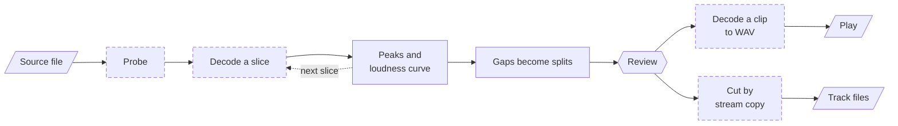

# Audio Splitter

Audio Splitter takes one long audio file of tracks played back to back and turns it into one file per track. It suggests where each track ends, lets you check every cut by eye and by ear, and writes the tracks to a folder without re-encoding them.

It runs entirely in the browser. The file is never uploaded: decoding, analysis and cutting all happen on your machine, through ffmpeg compiled to WebAssembly.

## Why it exists

I work to music without vocals. It's easy to listen to, and it keeps me inside what I'm doing instead of pulling my attention somewhere else. For chores I put on familiar soundtracks from games and films. Either way the music must not be new to me, because something new is a distraction.

That kind of music often comes as one long file: an hour or three of tracks played back to back. Split into separate tracks, it can go into a music player and be shuffled. Audio Splitter does that split.

The project has a second, equal reason: I wanted to learn how digital audio works by watching the tool being built. Each milestone taught one idea and wrote it up as a short [concept note](#concept-notes) before any code was written. The signal processing is written by hand rather than taken from a library, because that's the part worth understanding.

## What it does

1. **Load** an `.m4a` (AAC), `.mp3`, `.opus` or `.ogg` (Vorbis) file, or an MP4, MOV, WebM or MKV video, whose first audio stream is used and picture ignored. Any other file gets a message saying what it is.
2. **Analyse.** The file is decoded in slices into a waveform and a loudness curve. A 1 h file takes a few seconds.
3. **Find splits.** The file opens as one track. Two settings, the silence threshold and the minimum gap length, tune which quiet gaps show, and one button turns the gaps, and the dips where the level falls far under its surroundings, into splits.
4. **Review.** Listen across a split, to a whole track, or to a range you drag out. Move, add and delete splits, name the tracks, and leave out the ones you don't want. "Find duplicates" leaves out a track that is the same recording as an earlier one, and points at a split that may be missing.
5. **Export** every track you kept into a new folder, or one track or range as a single file. Tracks are audio-only files in the source's audio format (`.m4a`, `.mp3`, `.opus` or `.ogg`), tagged and never re-encoded.

**Requirements:** desktop Chrome, because the export writes through the File System Access API. Everything is kept in memory, so a reload starts over; only the volume, the mute, the play speed, the theme and your default settings are remembered.

**Not in v1:** CUE sheets, smarter detection, snapping to the quietest point, re-encoded or sample-accurate cuts, help with playlists that repeat, other formats and browsers, and keeping splits across a reload. The reasons are in the [wayfinding map](.scratch/audio-splitter/map.md#out-of-scope).

## How it works



Dashed boxes are ffmpeg.wasm commands; the rest is the app's own code. Each step is explained in a [concept note](#concept-notes). How the code is organised is in [docs/architecture.md](docs/architecture.md).

## Running it

You need Node 24 (pinned in `mise.toml`), pnpm and desktop Chrome.

```sh
pnpm install
pnpm dev        # then open the printed URL in Chrome
```

`pnpm verify` type-checks, runs the unit specs and builds. The 40 s fixtures in `e2e/fixtures/` are quick files to try by hand.

Contributing, or handing the repo to a coding agent? Start with [AGENTS.md](AGENTS.md).

## Documentation

### Concept notes

One screen each, with worked numbers from a real 1 h file.

1. [Sound is numbers](docs/concepts/01-sound-is-numbers.md): samples, channels, container and codec, peaks.
2. [Long files](docs/concepts/02-long-files.md): memory, slices and pre-roll.
3. [Loudness](docs/concepts/03-loudness.md): RMS and decibels.
4. [Gaps become splits](docs/concepts/04-gaps-become-splits.md): thresholds and the default.
5. [Time on screen](docs/concepts/05-time-on-screen.md): time to pixels, one array at two scales.
6. [Seeking compressed audio](docs/concepts/06-seeking-compressed-audio.md): frames, VBR and WAV.
7. [Cutting without re-encoding](docs/concepts/07-cutting-without-re-encoding.md): stream copy and its limits.
8. [Listening to a range](docs/concepts/08-listening-to-a-range.md): WAV size, and long tracks through a moving window.
9. [Volume is gain](docs/concepts/09-volume-is-gain.md): gain and decibels.
10. [Speed without pitch](docs/concepts/10-speed-without-pitch.md): resampling against time-stretching.
11. [Finding repeats](docs/concepts/11-finding-repeats.md): sliding one loudness curve along another.
12. [Streams in a container](docs/concepts/12-streams-in-a-container.md): why moving the audio out of a video changes no sound.
13. [The adaptive threshold](docs/concepts/13-adaptive-threshold.md): a line that follows the music, and depth as a confidence.

### Other docs

- [docs/architecture.md](docs/architecture.md): the stores, the ffmpeg session and the main flows.
- [GLOSSARY.md](GLOSSARY.md): the project's words.
- [DESIGN.md](DESIGN.md): the visual system.
- [CHANGELOG.md](CHANGELOG.md): what changed in each release.
- Planning record: the [v1 plan](.scratch/audio-splitter/milestones.md) (retired), and the [wayfinding map](.scratch/audio-splitter/map.md) with its decision tickets.

## What's next

v1 is complete. v2 will be planned the same way, one audio concept per milestone, starting with the app as a general cutting tool (gaps on request, saved default settings, tracks left out of the export), then help for playlists that repeat.

## Licence

The code is [MIT](LICENSE).

Builds also include third-party code under its own licence. The ffmpeg core (`@ffmpeg/core` 0.12.10) is GPL-2.0-or-later and is copied into every build, so a public deployment distributes a GPL program and should link to [its source](https://github.com/ffmpegwasm/ffmpeg.wasm) and licence. The Albert Sans font is under the SIL Open Font License, included in `src/app/styles/fonts/`.
