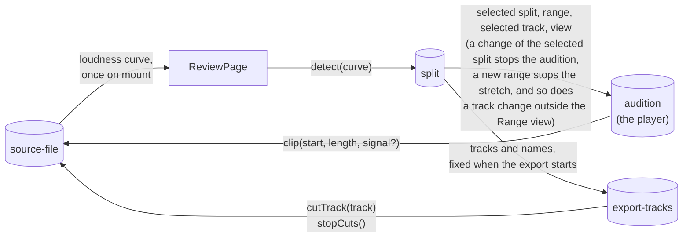
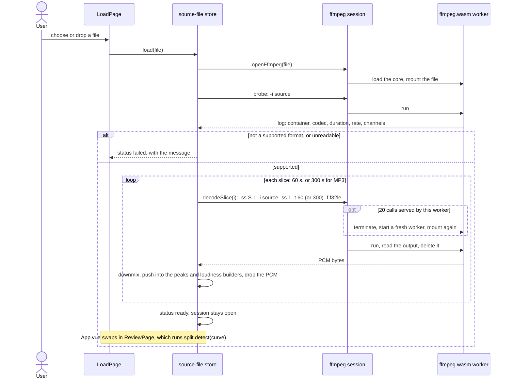
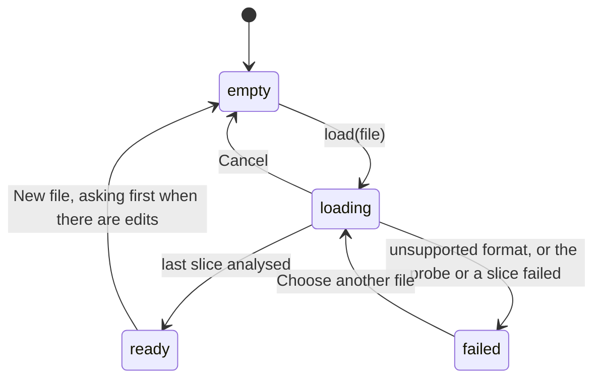
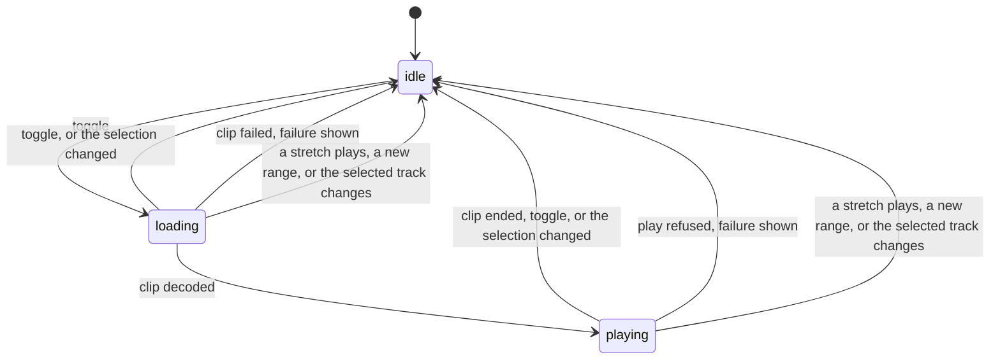
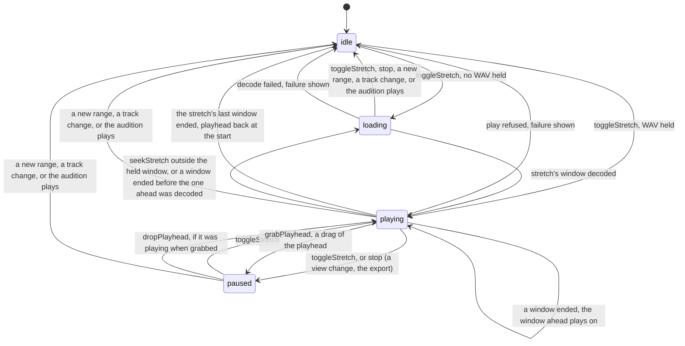
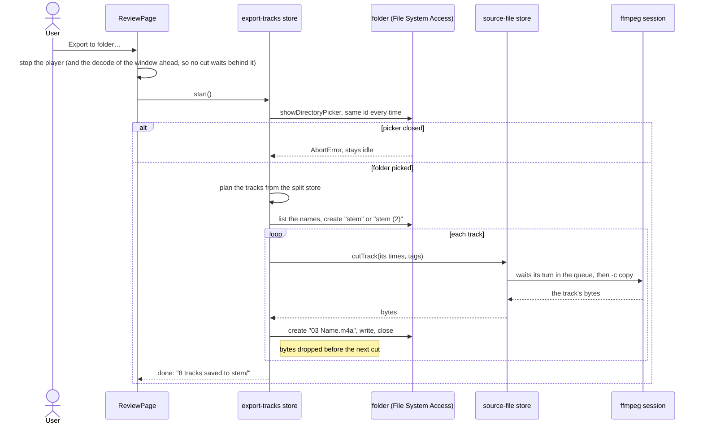
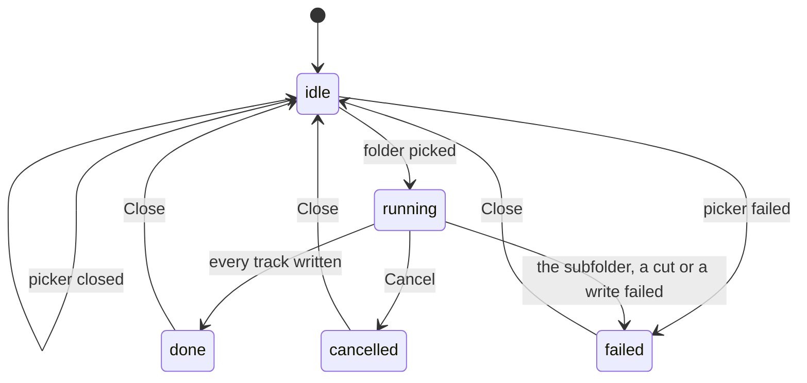

# Architecture

The [README](../README.md#architecture) shows the pipeline and the layers. This page goes one level down: how the stores pass data to each other, how the one ffmpeg session is shared, and how the load, player and export flows run. The folder-by-folder map is in [AGENTS.md](../AGENTS.md#code-layout); the words are defined in [GLOSSARY.md](../GLOSSARY.md).

The diagrams are drawn from the code. When a change alters what one of them shows (a store's status, a step in a flow, who calls whom), the diagram changes in the same commit.

## The stores

Five Pinia setup stores hold all state, in memory only. Two are entities; three belong to the widget that owns the behaviour.

| Store              | Slice                      | Holds                                                                                                                                                                                                                                                                                                    |
| ------------------ | -------------------------- | -------------------------------------------------------------------------------------------------------------------------------------------------------------------------------------------------------------------------------------------------------------------------------------------------------- |
| `source-file`      | `entities/source-file`     | The file, its format and duration, peaks, loudness curve, slice progress, load failure, the ffmpeg session                                                                                                                                                                                               |
| `split`            | `entities/split`           | The silence threshold and minimum gap length, the gaps, the splits with their track names, the derived tracks, the one selection (a split, a track or nothing; the selected split and the selected track are derived from it), the zoom window, the range, the mark and the panel's view, the edit count |
| `audition`         | `widgets/split-zoom`       | Whether the audition's clip and the stretch's (range or track) are loading, playing or paused, the failure, the stretch's resting place                                                                                                                                                                  |
| `export-tracks`    | `widgets/track-strip`      | The export's status, the track in hand, the counts, the subfolder's name, the failure                                                                                                                                                                                                                    |
| `shortcuts-dialog` | `widgets/shortcuts-dialog` | Whether the shortcuts dialog is open                                                                                                                                                                                                                                                                     |

- **`split` can't import `source-file`**, because two slices of one layer never import each other. `ReviewPage` reads the curve and hands it to `split.detect` when it mounts, and `split` keeps a reference to it to find the gaps again when a setting changes. When the page unmounts, it stops the player and resets `split`.
- **Widgets read the entity stores directly.** Every widget reads `split` for the splits, tracks and selection; all but the track list also read `source-file`, for the peaks, the curve, the duration or the session's calls.
- **Deleting a split merges the tracks either side of it.** **Removing a track is two of these.** `split.removeTrack` deletes the splits at both ends of a track (one at an edge, none for the only track); the removed track's name goes with its start split, and when the first track goes the next track's name moves to the file's start. Three places call `split.deleteSplit`: the "Delete split" button in the zoom view's title row (`ReviewPage`), Delete and Backspace on the split's handle (`SplitZoom`), and the trash button on a split row of the Track list. It counts as one edit for a detected split and takes the "added" edit back for an added one. A selected split that goes falls back to its neighbour; a selected track whose start split goes is re-keyed to the merged track, and any other selection stays.
- **The shortcuts dialog's flag is shared by three places.** The header's `?` button (`App.vue`) and the `?` key (`ReviewPage`, through `useQuestionMarkKey`, which ignores a text field, Ctrl, Cmd and Alt, and a page that already has a dialog open) set it; the dialog on `ReviewPage` shows it, and the page clears it when it unmounts. The dialog reads the split store's `view` only to put the view on show first. Its rows are written by hand in `widgets/shortcuts-dialog/config/shortcut-sections.ts`, so a change to a key or a gesture changes its row in the same commit.
- **A setting change replaces every split and name.** With edits made, the loudness panel's replace guard holds the change back and asks first; "Replace" applies it and clears the edit count. "New file" asks the same way in `App.vue`.

## The ffmpeg session

[`shared/api/ffmpeg/ffmpeg.ts`](../src/shared/api/ffmpeg/ffmpeg.ts) wraps one ffmpeg.wasm worker with the source file mounted read-only (WORKERFS), so ffmpeg reads only the bytes it asks for. Three rules keep it alive through long files:

- **A watchdog on every call.** A call into the worker can hang without answering, so each one races a timeout. On timeout the worker is terminated, the only thing that stops it.
- **A fresh worker every 20 calls.** ffmpeg ends each call by throwing, and its small call stack wears down; measured failures started at the 75th call. Before the 21st call (and after any terminated worker) the session starts a fresh worker and mounts the file again, which takes under 100 ms. Callers never see it.
- **`interrupt()` stops the running command.** It rejects the call with "ffmpeg was stopped" and terminates the worker; the next call starts a fresh one.

The `source-file` store opens the session when a load starts and keeps it open once the file is ready. After that, audition and range clips and export cuts go through `inSession`, a promise queue that runs one call at a time, because one worker runs one command and the session's log belongs to one call. A call whose file was reset or replaced while it waited rejects with `FileReplacedError`, so a result from the old file never reaches the new one.

## Load

Each load takes a number. A load that finishes after "New file", Cancel or a newer load finds its number stale and changes nothing; its session is closed.

`App.vue` shows the load page in `empty`, `loading` and `failed`, and the review page in `ready`. A failure names the step ("slice 41 of 62") and ffmpeg's last log line.

## Player

One store, `audition`, is the one player: a hidden `<audio>` element plays a WAV the `source-file` store decodes (a start and a length, `-c:a pcm_s16le -f wav`, with the same 1 s pre-roll as a slice), and at most one decoded window of one stretch (and the window after it) is held. It has two kinds of listening, each with its own status, and starting one stops the other.

**The audition** is the 8 s across the selected split (the split ±4 s). "Play across split" and Space on the zoom view's handle both call `toggle`. The zoom view draws the playhead each animation frame from the element's `currentTime` plus the clip's start.

**The stretch** is the range the user dragged out (note 08) or the selected track. The Range view's and the Track view's Play button and Space both call `toggleStretch(stretch)`: the player plays a stretch (a start and an end the caller hands in: the range as it is, a track as its whole extent). It reads the split store only to word a failure and to stop when the range or the selected track changes. A stretch of 10 min or less is one window: decoded once and kept, tied to the stretch it was decoded for (a different stretch, a range after a track or the other way round, releases it and decodes its own), so a pause costs nothing: playing again sets the element's `currentTime` inside the WAV, which is exact, and plays at once. Both views draw the playhead each animation frame while it plays, and at its resting place otherwise: the stretch's start for a new stretch and after the end. The resting place names the stretch it belongs to, so a view of another stretch never draws it. The playhead moves without changing the status: `seekStretch` sets `currentTime` while the stretch plays, and the resting place otherwise (which `toggleStretch`, or the clip still being decoded, starts from); a drag of it goes through `grabPlayhead`, which pauses a playing stretch, and `dropPlayhead`, which plays it on only if it was playing.

**A long track moves a window along it.** At most 10 min of WAV is decoded at a time, so `lib/decode-window.ts` decides, for a stretch and a playhead, the window to decode (the 10 min from the playhead, held to the stretch's end; the whole stretch when it is 10 min or less), whether a time is inside a window, and when the next window is due. The first press decodes the window that holds the playhead. A seek inside the held window sets `currentTime`; a seek outside it releases the windows and decodes one from the seek point (the stretch reads as decoding meanwhile), and a seek to the stretch's very end ends the stretch. While a window plays, `timeupdate` asks for the window ahead once the playhead is 30 s from the end of the playing one, once per window. When the element's `ended` event comes, the player points the element at that window and plays on: no decode, and a break of about 60 ms, which is the element loading a new source (note 08). When the window ahead is not decoded yet (a seek close to the end of the window) the stretch reads as decoding until it arrives, and a decode that failed ahead is tried again then, with its failure shown. The window ahead is dropped if the windows are released meanwhile, or on `stop()` (a view change, the export): its fetch is forgotten and its decode stopped (`clip` takes an `AbortSignal`; a queued clip never runs and a running one is interrupted), so a seek's window or the export's cuts do not wait behind it, and a window that arrives late is never held. At most two windows are held.

A track change is another selected track, none, or the selected track's start or end moving (a split deleted, moved or added at its edge, a neighbour removed). It stops the stretch in every view but the Range view, where the stretch is the range: a split added at the mark or at the playhead (Shift+Enter) shortens the selected track, and the range plays on.

Every press takes a number, and a clip that arrives for an older press is dropped, so a stopped press, a changed selection or a new range never starts sound later. "The selection changed" covers moving the selected split, selecting another, deselecting, deleting and a setting change; a synchronous watcher on the split store stops the audition at once. A second synchronous watcher on the range, and a third on the selected track (its identity, start and end, so a split that moves elsewhere changes nothing; it does nothing while the Range view is shown), stop all sound, drop the decoded stretch and put the playhead at the new stretch's start. The page stops the player on a view change, when the export starts and when it unmounts: a stretch that plays is paused, so its playhead stays where it was.

## Export

- **Cancel** calls `stopCuts()`: the running call is interrupted, every cut still queued rejects without running, and the files already closed stay on disk.
- **A failed write** aborts its writable and removes the empty file Chrome made for it, so the folder only ever holds whole tracks. That file is the only thing the app deletes, and it made it a moment before, in the subfolder it made.
- **The tracks are fixed when the export starts**, and the overlay locks the page while it runs, so an edit can't change a run halfway through.
- **One track is in memory at a time.** Each is cut, written and dropped before the next is cut.

A failure names the track that failed, when there was one. The cut commands per format, and why `.mp3` and `.opus` seek twice, are in [concept note 07](concepts/07-cutting-without-re-encoding.md).
