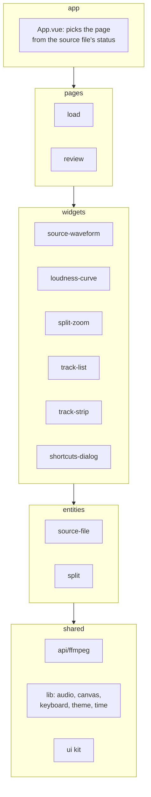
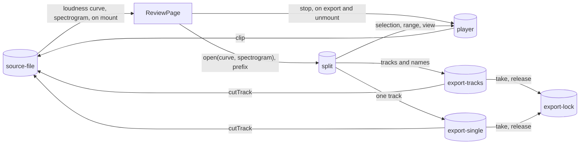
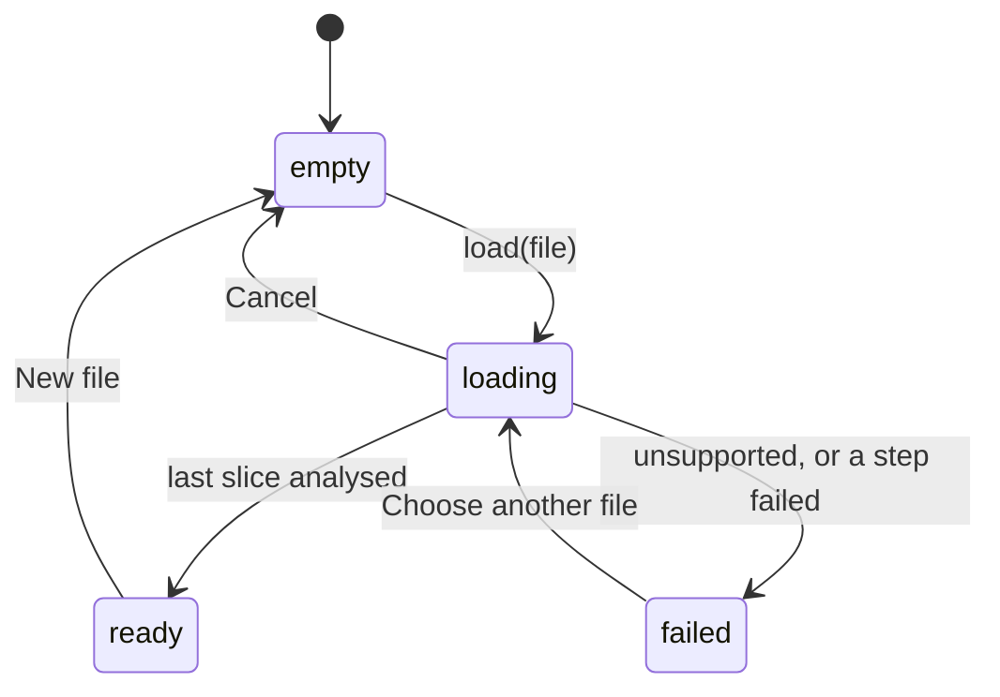
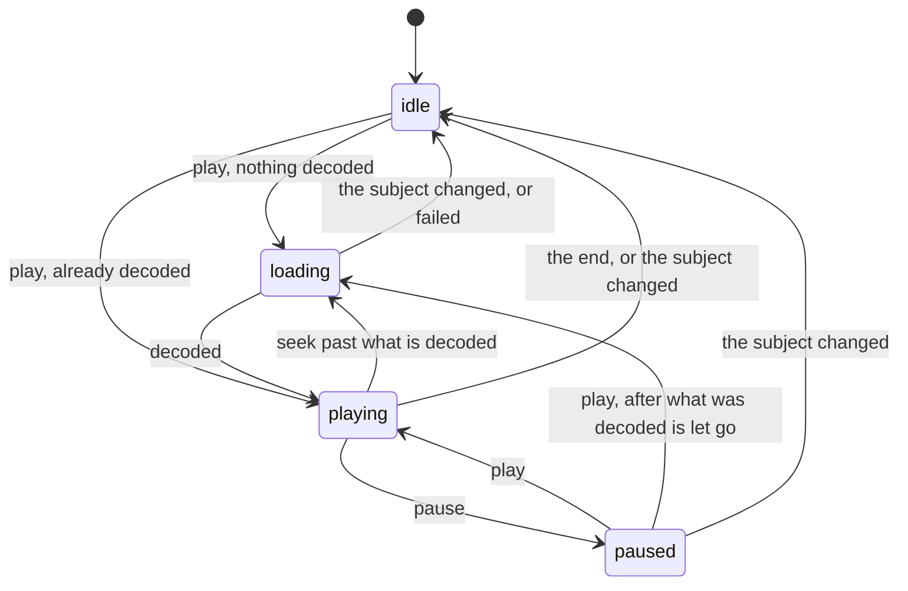
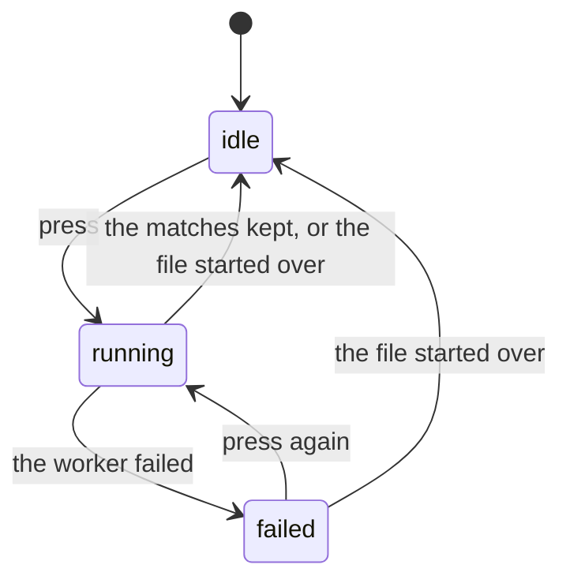
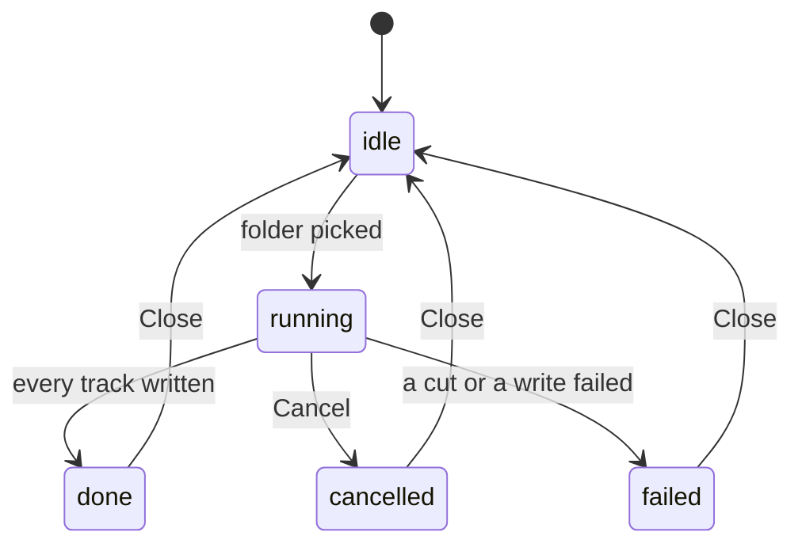
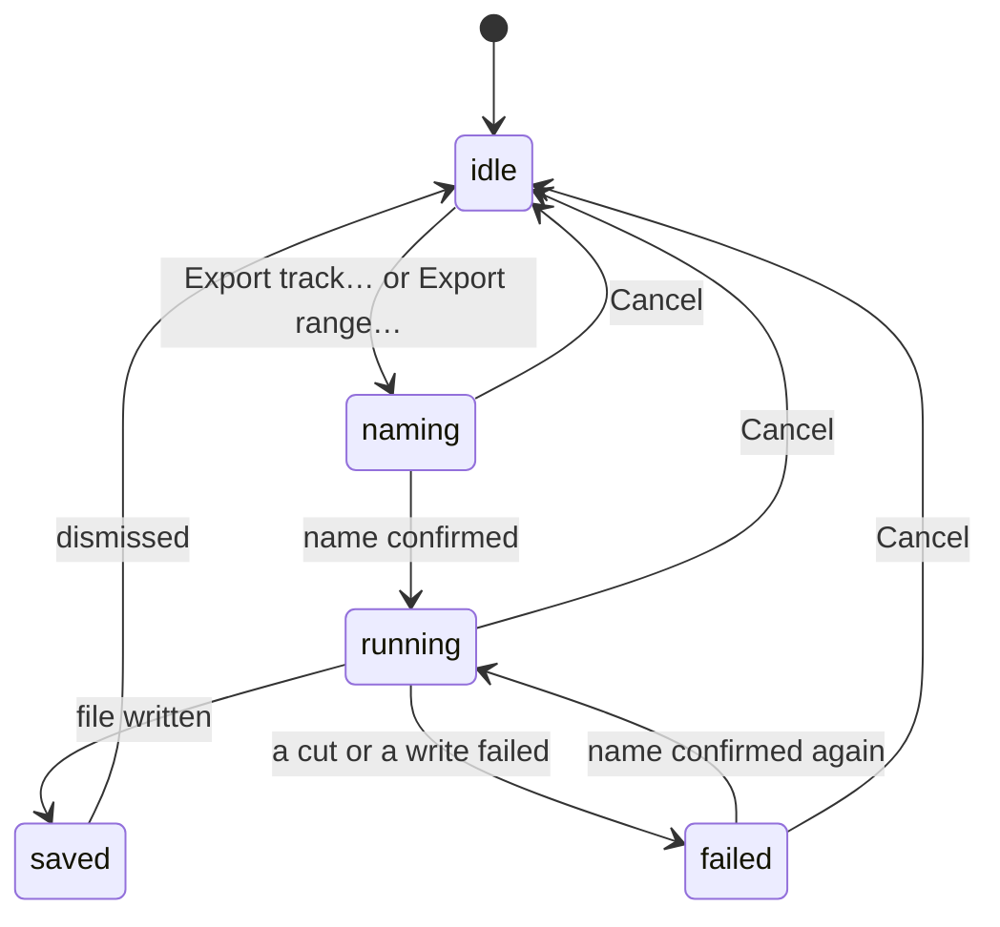

# Architecture

How the code is put together: the layers, the stores and how they connect, the ffmpeg session, and the load, player, Find duplicates and export flows with their statuses. The folder map is in [AGENTS.md](../AGENTS.md#code-layout), the words in [GLOSSARY.md](../GLOSSARY.md). What each feature does is in the code and its specs.

## Layers

A Vue 3 single-page app with no backend, in a subset of Feature-Sliced Design ([ADR 0001](adr/0001-fsd-subset.md)).

An arrow means "may import from". Two slices of one layer never import each other. `pnpm lint` enforces both rules.

## The stores

The app's state lives in Pinia setup stores, in memory. The volume, the mute flag, the play speed and the default settings are also saved in `localStorage`.

| Store              | Slice                      | Holds                                                    |
| ------------------ | -------------------------- | -------------------------------------------------------- |
| `source-file`      | `entities/source-file`     | The file, its summaries, load progress, the ffmpeg session |
| `split`            | `entities/split`           | Settings, splits, tracks, matches, selection, edits      |
| `player`           | `widgets/split-zoom`       | The one player and what it plays                         |
| `export-tracks`    | `widgets/track-strip`      | The export to a folder                                   |
| `export-single`    | `widgets/track-strip`      | The export of one track or range                         |
| `export-lock`      | `widgets/track-strip`      | Which export runs                                        |
| `shortcuts-dialog` | `widgets/shortcuts-dialog` | Whether the shortcuts dialog is open                     |

Two modules live inside the `split` store rather than beside it:

- **Matches** ([`matches.ts`](../src/entities/split/model/matches.ts)) hold Find duplicates' results and status.
- **The edit ledger** ([`edit-ledger.ts`](../src/entities/split/model/edit-ledger.ts)) counts the user's edits.

- **`split` can't import `source-file`.** `ReviewPage` hands it the loudness curve, the spectrogram and the track name prefix once, on mount.
- **Widgets read the entity stores directly.** They never go through another widget.
- **Tracks are derived from the splits**, never stored.
- **One selection at a time:** a split, a track or nothing.
- **Changes that drop the user's work ask first.** The `split` store holds such an action as a question (`unlessItDiscards` in `split.ts`).
- **A late result is dropped.** Every press takes a number, and a result that arrives for an older number changes nothing.
- **The two export stores can't import each other**, so `export-lock` sits between them.

## The theme

[`theme.ts`](../src/shared/lib/theme/theme.ts) holds the theme choice and the theme in effect as plain Vue state, so the kit and the canvases can read it from any layer. It saves the choice in `localStorage` and sets `data-theme` and `color-scheme` on `<html>`. A script in `index.html` sets the same two before the first paint.

## The ffmpeg session

[`ffmpeg.ts`](../src/shared/api/ffmpeg/ffmpeg.ts) wraps one ffmpeg.wasm worker, with the source file mounted read-only. Every call has a timeout, the worker is replaced after a set number of calls, and `interrupt()` terminates it.

The `source-file` store keeps the session open once the file is ready. Clips and cuts share it through `inSession`, a queue that runs one call at a time. A call for a file that has since been replaced rejects with `FileReplacedError`.

### The core download

[`core-preloader.ts`](../src/shared/api/ffmpeg/core-preloader.ts) downloads the ffmpeg core once per page, before the first worker starts. A service worker serves it from Cache Storage, so a returning visitor downloads nothing ([ADR 0003](adr/0003-ffmpeg-core-in-cache-storage.md)).

## Load

`load(file)` opens the session, probes the file, then decodes it slice by slice, adding each slice to the summaries and dropping its samples. `App.vue` shows the load page until the store is `ready`.

## Player

The `player` store is the one player. The `source-file` store decodes a stretch of the file to WAV, and a hidden `<audio>` element plays it ([`audio-element.ts`](../src/widgets/split-zoom/api/audio-element.ts)). It plays the subject on show, which it reads from the `split` store.

There are two kinds of listening: the audition across the selected split, and a stretch (the range or a track). They share one status, owned by one of them at a time; starting one takes the status from the other. How a long stretch plays through a moving window is in [`decode-window.ts`](../src/widgets/split-zoom/lib/decode-window.ts) and [note 08](concepts/08-listening-to-a-range.md); the rest of the player's rules are in the header comment of [`player.ts`](../src/widgets/split-zoom/model/player.ts).

The volume and the play speed apply to the element only, so they never reach an exported file ([ADR 0004](adr/0004-time-stretching-by-the-browser.md)).

## Find duplicates

Find duplicates compares the tracks in a second worker, beside ffmpeg's ([note 11](concepts/11-finding-repeats.md)). The matches module sends the request through [`find-matches-client.ts`](../src/entities/split/api/find-matches-client.ts), which starts a worker per press and terminates it with its answer, or when the file starts over. The track list, the track strip, the Track view and the export read the live matches from `split`.

## Export

`export-tracks` picks a folder, then cuts and writes one track at a time with `cutTrack`. The tracks are fixed when it starts. A failed write removes its empty file, so the folder holds only whole tracks. The cut commands are in [note 07](concepts/07-cutting-without-re-encoding.md).

### Single export

`export-single` writes one track or the range as one file, under a name the user confirms. It shares the file writing ([`write-file.ts`](../src/widgets/track-strip/api/write-file.ts)), naming and tags with the full export.

