# Architecture

How the code is put together: the layers, the stores and how they connect, the ffmpeg session and the search worker, and the load, player, search and export flows. The folder map is in [AGENTS.md](../AGENTS.md#code-layout), the words in [GLOSSARY.md](../GLOSSARY.md). What each feature does is in the code and its specs.

## Layers

A Vue 3 single-page app with no backend, in a subset of Feature-Sliced Design ([ADR 0001](adr/0001-fsd-subset.md)).

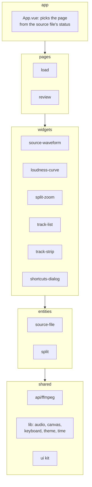

An arrow means "may import from". Two slices of one layer never import each other. `pnpm lint` enforces both rules.

## The stores

All state lives in Pinia setup stores, in memory, except the theme ([below](#the-theme)). Only the volume, the mute flag, the play speed, the default settings and the theme choice are also saved, in `localStorage`.

| Store              | Slice                      | Holds                                                                         |
| ------------------ | -------------------------- | ----------------------------------------------------------------------------- |
| `source-file`      | `entities/source-file`     | The file, its analysis, load progress and the ffmpeg session                  |
| `split`            | `entities/split`           | Settings, splits and their confidence, track names, matches, selection, edits |
| `audition`         | `widgets/split-zoom`       | The one player: what plays, its status, volume and play speed                 |
| `export-tracks`    | `widgets/track-strip`      | The export of every track not left out into a folder                          |
| `export-single`    | `widgets/track-strip`      | The export of one track or range as a single file                             |
| `export-lock`      | `widgets/track-strip`      | Which export is running, so the two never overlap                             |
| `shortcuts-dialog` | `widgets/shortcuts-dialog` | Whether the shortcuts dialog is open                                          |

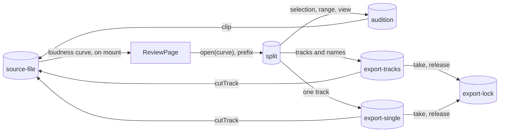

- **`split` can't import `source-file`.** `ReviewPage` hands it the loudness curve and the track name prefix once, on mount. The file opens as one track with no splits. `split` works out how deep every window falls under its surroundings once, and "Find splits" turns the gaps and the dips into splits, one per boundary.
- **Widgets read the entity stores directly.** They never go through another widget.
- **A split's confidence is set once**, by "Find splits", from its depth, and goes when the user moves the split or marks it checked. `{` and `}` walk the splits that still have one, least sure first.
- **Tracks are derived from the splits**, never stored. Deleting a split merges the tracks either side of it.
- **Matches are stored as found, and whether one holds is derived.** A match keeps both tracks' ends, so an edit never has to find it: it is live while both tracks still have them.
- **One selection at a time:** a split, a track or nothing.
- **Changes that drop the user's work ask first.** "New file" and "Clear splits" ask when there are edits or pending splits; a setting change asks nothing, since it changes only the gaps. Any action that would drop pending splits is held as a question in `split` (see `unlessItDiscards` in `split.ts`).
- **The two export stores can't import each other**, so `export-lock` sits between them.

## The theme

[`theme.ts`](../src/shared/lib/theme/theme.ts) in `shared/lib/theme` holds the theme choice (`system`, `light` or `dark`) and the theme in effect (`light` or `dark`) as plain Vue state, not a store, so the kit and the canvases can read it from any layer.

- The choice is saved in `localStorage` and read back on start.
- The theme in effect is the choice, or the OS's scheme while the choice is `system`. The OS is listened to only then.
- It sets `data-theme` and `color-scheme` on `<html>`. The CSS keys its one dark block on the attribute.
- A script in the head of `index.html` sets the same two from the same saved choice before the first paint. `startTheme` in `main.ts` takes over from there.
- The switch in the header (`App.vue`) shows the choice and sets it.
- `useCanvasRedraw` redraws every canvas when the theme in effect changes.

## The ffmpeg session

[`ffmpeg.ts`](../src/shared/api/ffmpeg/ffmpeg.ts) wraps one ffmpeg.wasm worker. The source file is mounted read-only, so ffmpeg reads only the bytes it needs. Three rules keep it alive through long files:

- **Every call has a timeout.** A hung call terminates the worker.
- **A fresh worker every 20 calls.** A worker wears out after a few dozen calls; a new one takes under 100 ms.
- **`interrupt()` stops the running command** by terminating the worker.

The `source-file` store keeps the session open once the file is ready. Clips and cuts share it through `inSession`, a queue that runs one call at a time. A call for a file that has since been replaced rejects with `FileReplacedError`.

### The core download

The ffmpeg core (32 MB) must be in the browser before the first worker starts. [`core-preloader.ts`](../src/shared/api/ffmpeg/core-preloader.ts) gets it there:

- One shared download for the whole page, started when the page is idle.
- It fails only when no bytes arrive for 30 s, so a slow connection still finishes.
- The core is kept in Cache Storage, and a service worker serves it to ffmpeg's worker, so a returning visitor downloads nothing. The service worker is registered in production builds only.

The reasons are in [ADR 0003](adr/0003-ffmpeg-core-in-cache-storage.md).

## Load

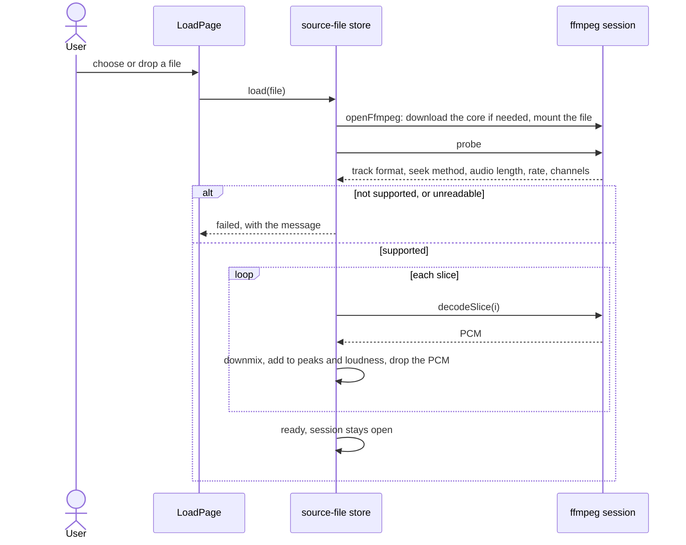

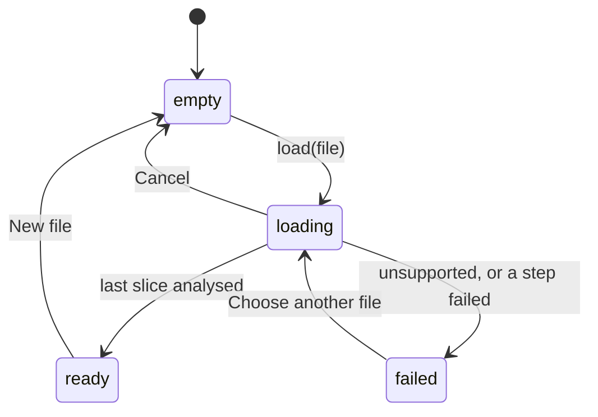

- `App.vue` shows the load page until the store is `ready`, then the review page.
- A failure names the step and ffmpeg's last log line.
- Each load takes a number. A load that a newer one replaced changes nothing.

## Player

The `audition` store is the one player. The `source-file` store decodes a stretch of the file to WAV, and a hidden `<audio>` element plays it. A WAV seeks exactly, which a compressed file does not ([note 06](concepts/06-seeking-compressed-audio.md)).

There are two kinds of listening. Starting one stops the other.

**The audition** plays the 8 s across the selected split, its extent: the split ±4 s, held to the file. It can pause and resume without decoding again. Its playhead is always known while a split is selected: the sound while it plays, else the resting place, else the extent's start.

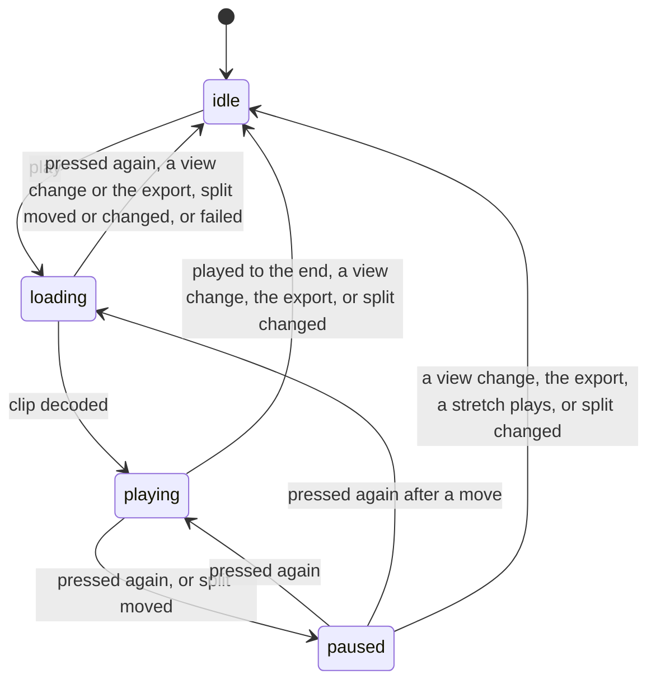

"Split changed" is another split selected, none, or the selected one deleted. When the resting place is kept or cleared is in the header comment of `src/widgets/split-zoom/model/audition.ts`.

**The stretch** plays a range or the selected track. It can pause, resume and seek without decoding again.

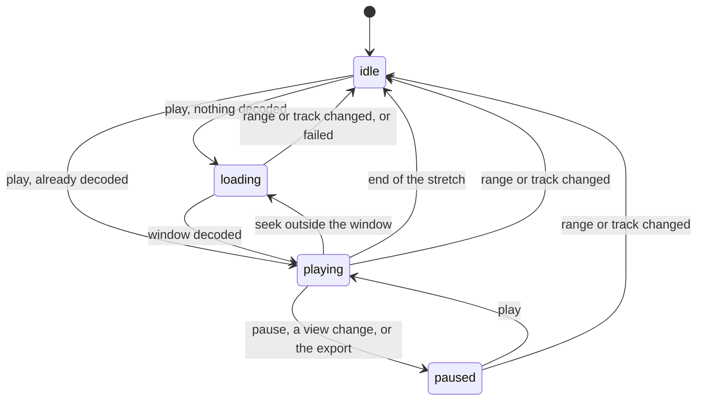

- **A long track plays through a moving window.** At most 10 min is decoded at a time. The next window is decoded while the current one plays, and at most two are held ([`decode-window.ts`](../src/widgets/split-zoom/lib/decode-window.ts), [note 08](concepts/08-listening-to-a-range.md)).
- **Watchers on the `split` store stop the sound at once** when the split, range or track it belongs to changes. A view change or the export only pauses a stretch, so its playhead stays.
- **Every press takes a number.** A clip that arrives for an older press is dropped, so stale sound never starts.
- **The volume and the play speed apply to the element only**, so they never reach an exported file ([note 09](concepts/09-volume-is-gain.md), [note 10](concepts/10-speed-without-pitch.md), [ADR 0004](adr/0004-time-stretching-by-the-browser.md)).

## Find duplicates

"Find duplicates" compares the tracks in a second worker, beside ffmpeg's. The idea is in [note 11](concepts/11-finding-repeats.md).

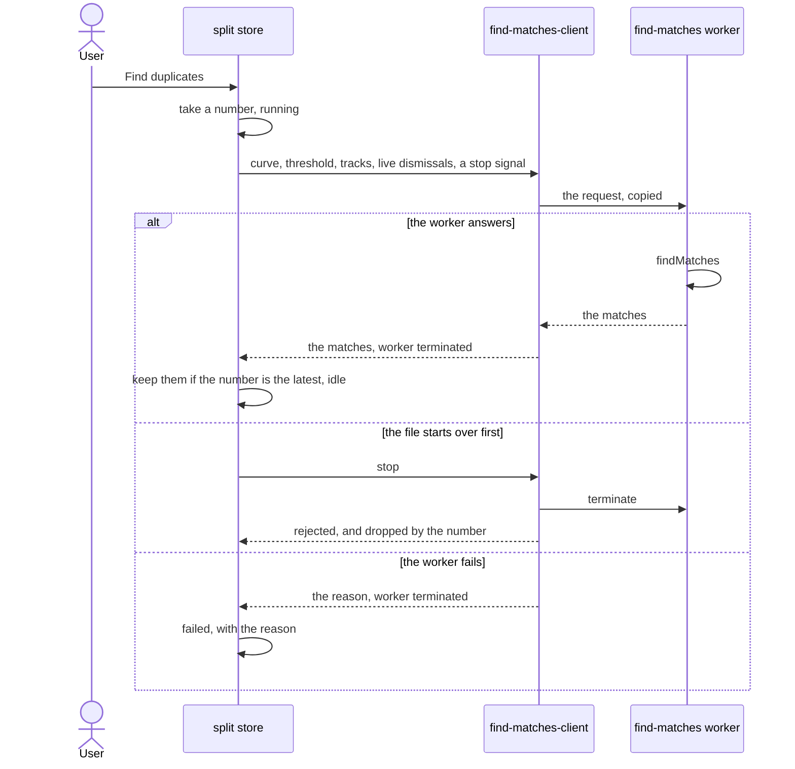

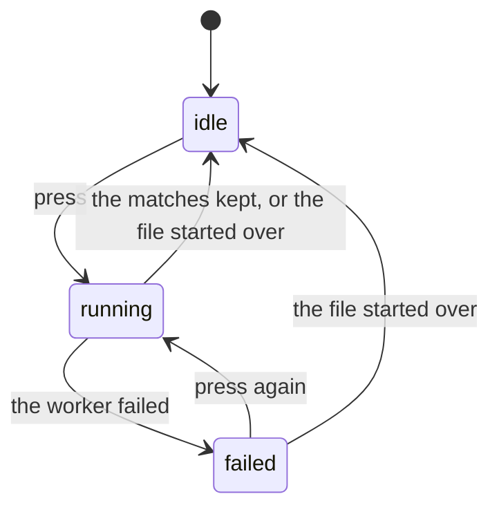

- **The worker does one job.** It is started per press and terminated with its answer, or as soon as the file starts over. Its entry only wires: the rules are in `lib/find-matches.ts`, which a store spec runs in the page through a fake client.
- **The request holds plain numbers.** A worker refuses a Vue proxy.
- **The matches drive other stores' views.** The track list, the track strip, the Track view and the export read the live matches from `split`; none of them stores a match.

## Export

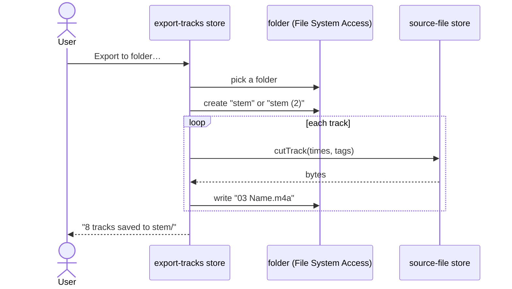

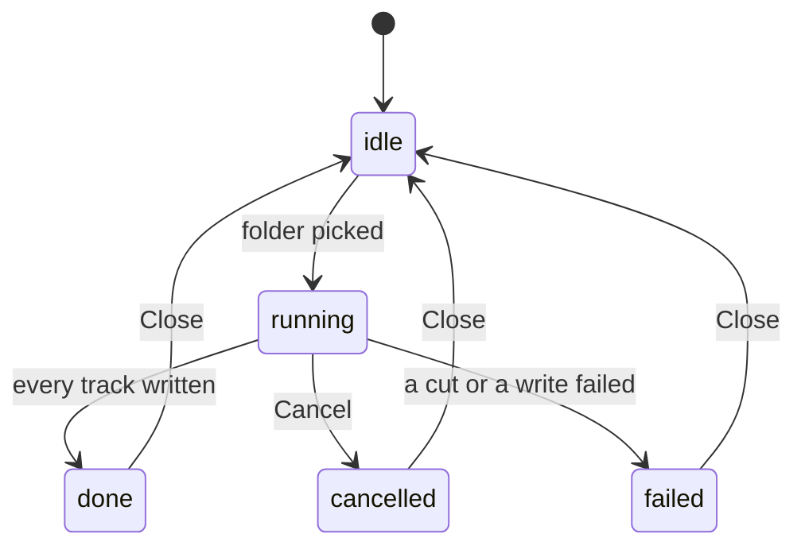

- **The tracks are fixed when the export starts**, and an overlay locks the page.
- **Tracks are audio-only files in the track format**, set by the source's codec, even when the source is a video.
- **One track is in memory at a time**: cut, written and dropped before the next.
- **Cancel** stops the running cut. Files already written stay.
- **A failed write removes its empty file**, so the folder only holds whole tracks.

The cut commands per seek method are in [note 07](concepts/07-cutting-without-re-encoding.md).

### Single export

`export-single` writes one track or the range as one file, under a name the user confirms. It shares the file writing ([`write-file.ts`](../src/widgets/track-strip/api/write-file.ts)), naming and tags with the full export.

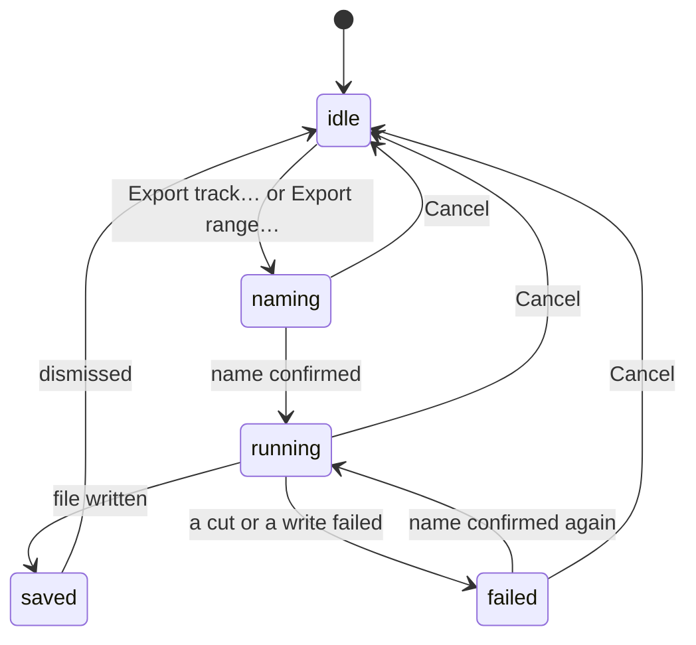

- The folder is picked once per source file.
- A name that is taken gets ` (2)`; nothing is overwritten.
